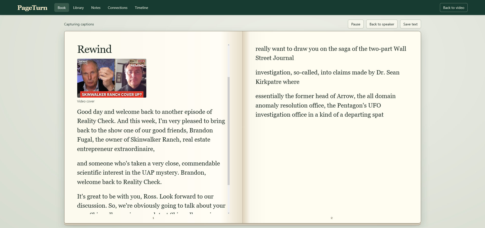

# PageTurn · YouTube study library

PageTurn is a Firefox extension that captures a YouTube video's captions as you watch and presents them as a two-page book. Open any video, click **Open study book**, and read along while you listen.

## Features

- Live caption capture into a two-page book view
- Book, Library, Notes, Connections and Timeline tabs
- Cross-video links when the same distinctive phrase appears in more than one chapter
- Page turning, Pause, Back to speaker, and Save text
- Dark mode, with a sun/moon toggle in the top bar next to Back to video. It follows your system theme by default, and remembers your choice
- Everything is stored locally in the browser, with no data collection

## Install

### Signed add-on (Firefox)

1. Download the signed `.xpi` from [Releases](../../releases).
2. Drag the file into Firefox and choose **Add**.

Version 0.2.0 is the current signed build. A signed 0.3.0 build, which includes dark mode, will be added to Releases after Mozilla signs it.

### Temporary install from source

1. Download or clone this repository.
2. In Firefox, open `about:debugging#/runtime/this-firefox`.
3. Choose **Load Temporary Add-on…** and select `manifest.json` from this repository.
4. Open a YouTube video, refresh the page, and click **Open study book**.

A temporary add-on is removed when Firefox restarts. For a permanent install, use the signed `.xpi` from Releases.

## Privacy

PageTurn does not collect or send your data. Your library, notes and history stay in your local browser storage and are never uploaded.

## Caption timing

Live capture depends on when YouTube displays each caption, so wording and timing can vary slightly from the official transcript.

## License

MIT. See [LICENSE](LICENSE).
